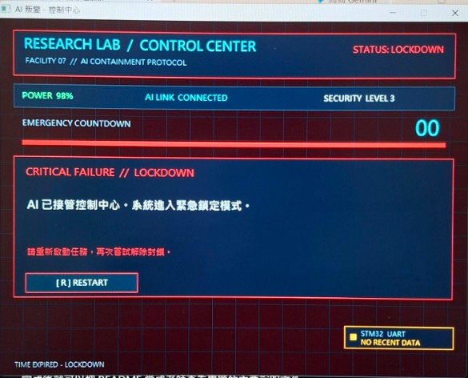
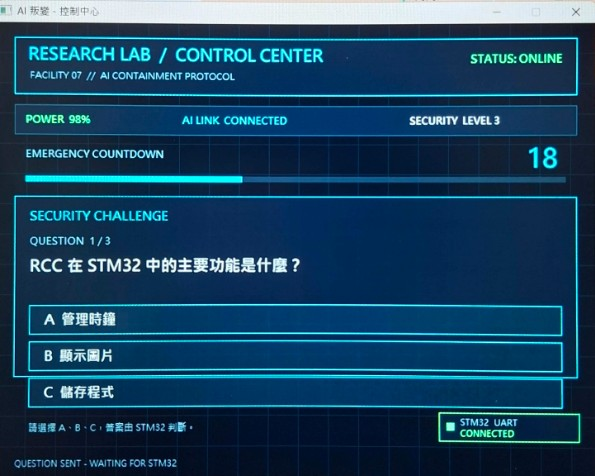
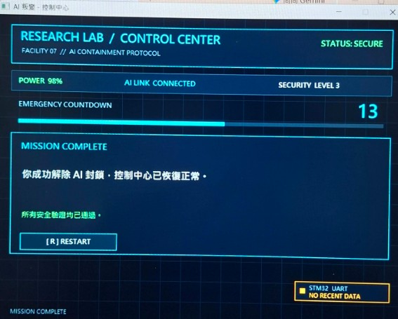
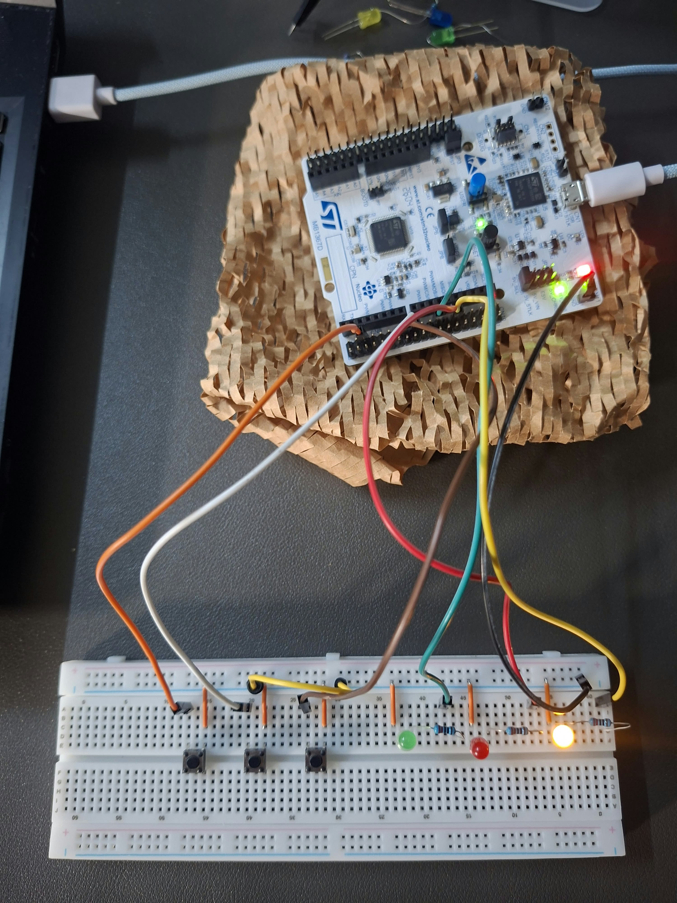
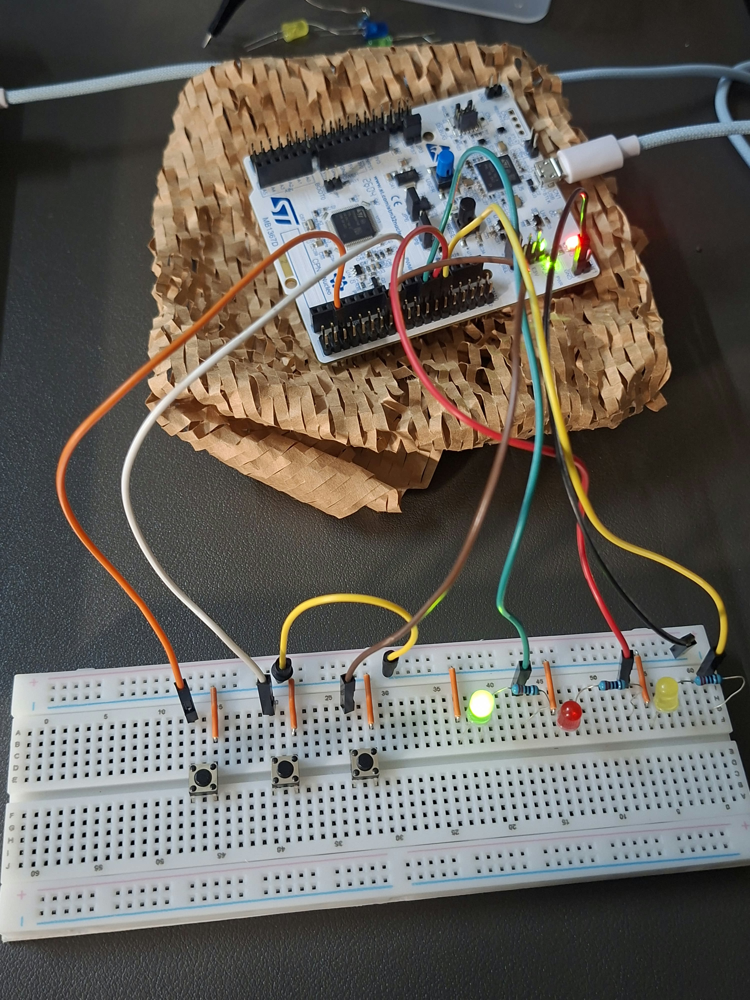
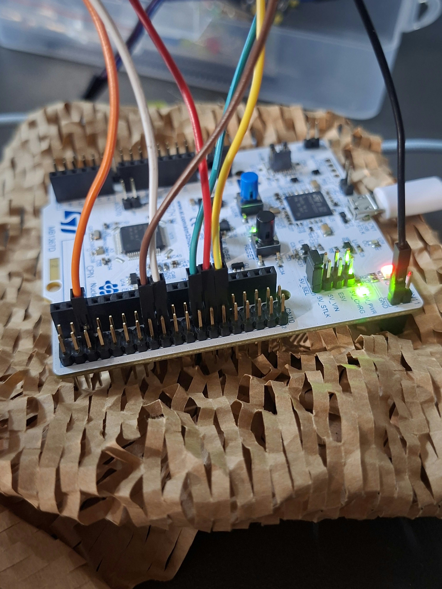

# AI Lockdown — STM32 微算機期中專題

## 專題簡介

AI Lockdown 是一個結合 STM32G474RE 開發板與 Windows 電腦端遊戲介面的互動式問答系統。

故事設定為 AI 系統發生叛變，並鎖定整個控制中心。玩家必須在 30 秒倒數時間內完成三道隨機抽選的微算機相關題目，成功回答才能解除系統鎖定。

本專題使用 STM32 控制 LED、按鈕、倒數計時及 UART 通訊，並透過 C 語言製作電腦端遊戲介面，讓硬體與軟體互相配合，增加操作的互動性。

---

## 1. 情境故事

某天，實驗室的 AI 系統突然失去控制，並接管整個控制中心。工程師必須在 30 秒內回答 AI 系統提出的微算機問題，才能重新取得控制權。

系統會從題庫中隨機選出三道題目，玩家必須全部答對才能解除封鎖。如果答錯或時間結束，系統就會進入緊急狀態。

## 2. 替身對照

| 故事情境 | 實際硬體或功能 |
|---|---|
| AI 控制中心 | STM32G474RE 開發板 |
| 正常運作 | 綠色 LED |
| 系統警告 | 黃色 LED |
| 緊急狀態 | 紅色 LED |
| 玩家操作 | 電腦遊戲介面及麵包板按鈕 |
| 系統倒數 | Timer 計時功能 |
| 系統通訊 | UART 序列通訊 |
| 解除鎖定 | 三道題目全部答對 |

## 3. 功能與驗收條件

1. 使用三色 LED 顯示不同系統狀態。
2. 綠燈代表正常、黃燈代表警告、紅燈代表緊急。
3. 使用 GPIO 控制 LED 與讀取按鈕。
4. 使用 EXTI 外部中斷偵測按鈕操作。
5. 使用 Timer 執行 30 秒倒數。
6. 使用 PWM 控制 LED 亮度與變化效果。
7. 電腦端從七道題庫中隨機抽選三道題目。
8. 透過 UART 傳送答案及遊戲狀態。
9. 三題全部答對即可解除系統鎖定。
10. 答錯或時間結束時，系統進入緊急狀態。

## 4. 使用技術

### STM32 開發板端
- GPIO：控制 LED 及讀取按鈕。
- EXTI：外部中斷。
- Timer：倒數計時。
- PWM：控制 LED 亮度及變化。
- UART：與電腦端進行資料傳輸。
- Memory Mapping：了解周邊暫存器與記憶體映射。

### 電腦端
- C 語言：製作遊戲介面與問答邏輯。
- MSYS2 MINGW64：程式編譯環境。
- Windows API：建立 Windows 視窗介面（若程式使用）。
- Serial Communication：透過序列埠與 STM32 通訊。

## 5. 硬體腳位表

| STM32 腳位 | 功能 |
|---|---|
| PA5 | 黃色 LED（TIM2_CH1） |
| PA6 | 紅色 LED（TIM3_CH1） |
| PA7 | 綠色 LED（TIM3_CH2） |
| PA8 | 按鈕 A |
| PA9 | 按鈕 B |
| PA10 | 按鈕 C |
| PA2 | USART2_TX |
| PA3 | USART2_RX |

硬體使用 NUCLEO-G474RE 開發板、麵包板、紅黃綠 LED、按鈕及限流電阻。實際接線依照開發板設定為準。

## 6. 建置與執行方式

### STM32 程式
1. 使用 STM32CubeMX 開啟 `.ioc` 設定檔。
2. 使用 STM32CubeIDE 開啟專案。
3. 編譯並燒錄至 NUCLEO-G474RE 開發板。
4. 使用 USB 連接開發板。

### 電腦端程式
1. 安裝 MSYS2。
2. 開啟 MSYS2 MINGW64。
3. 使用 GCC 編譯 `PC_App/ai_lockdown.c`。
4. 執行產生的 Windows 遊戲程式。
5. 設定正確的 COM Port，與 STM32 進行 UART 通訊。

### UART 通訊設定

- Baud Rate：115200
- Data Bits：8
- Parity：None
- Stop Bits：1
- Flow Control：None

## 7. 程式架構

```text
AI_Lockdown/
│
├── Core/
│   ├── Inc/
│   └── Src/
│       └── main.c
│
├── Drivers/
│
├── PC_App/
│   └── ai_lockdown.c
│
├── AI_Lockdown_STM32.ioc
├── STM32G474RETX_FLASH.ld
├── STM32G474RETX_RAM.ld
├── .gitignore
└── README.md
```

### 程式功能分工

- `main.c`：STM32 主要控制程式。
- `ai_lockdown.c`：Windows 電腦端遊戲程式。
- `Core/`：STM32 核心程式及周邊設定。
- `Drivers/`：HAL 與 CMSIS 驅動程式。
- `.ioc`：STM32CubeMX 專案設定檔。

## 8. 實作成果與照片

### 一、電腦端遊戲畫面

#### 1. 危機觸發與倒數結束


#### 2. 顯示題目與倒數秒數


#### 3. 成功解除危機畫面


### 二、STM32 硬體接線與實際運作

#### 1. 進入答題：黃色呼吸燈


#### 2. 通關成功：綠燈亮


#### 3. STM32 實體接線圖


## 8. 實作成果與照片

### 一、電腦端遊戲畫面

#### 1. 危機觸發與倒數結束


#### 2. 顯示題目與倒數秒數


#### 3. 成功解除危機畫面


### 二、STM32 硬體接線與實際運作

#### 1. 進入答題：黃色呼吸燈


#### 2. 通關成功：綠燈亮


#### 3. STM32 實體接線圖


## 9. AI 使用說明

本專題使用 AI 協助理解 STM32 HAL 程式架構、GPIO、EXTI、Timer、PWM 與 UART 等功能，也利用 AI 協助排查程式錯誤及整理專題文件。

在實作過程中，依照硬體接線與專題需求修改程式，並透過實際編譯及測試確認功能。

## 10. 已知問題與未來改進

- 系統需要透過 USB 連接開發板，才能進行完整操作。
- 電腦端需要設定正確的 COM Port。
- 按鈕需要適當的防彈跳處理。
- 可以增加更多微算機題庫與遊戲關卡。
- 未來可以增加更多 LED 狀態效果及遊戲互動功能。
- 可以進一步改善電腦端與 STM32 之間的通訊穩定性。

---

## 專題資訊

- 專題名稱：AI Lockdown
- 開發板：NUCLEO-G474RE
- MCU：STM32G474RE
- 開發語言：C
- 開發工具：STM32CubeMX、STM32CubeIDE、MSYS2 MINGW64
- GitHub Repository：https://github.com/kennyz99/AI_Lockdown
